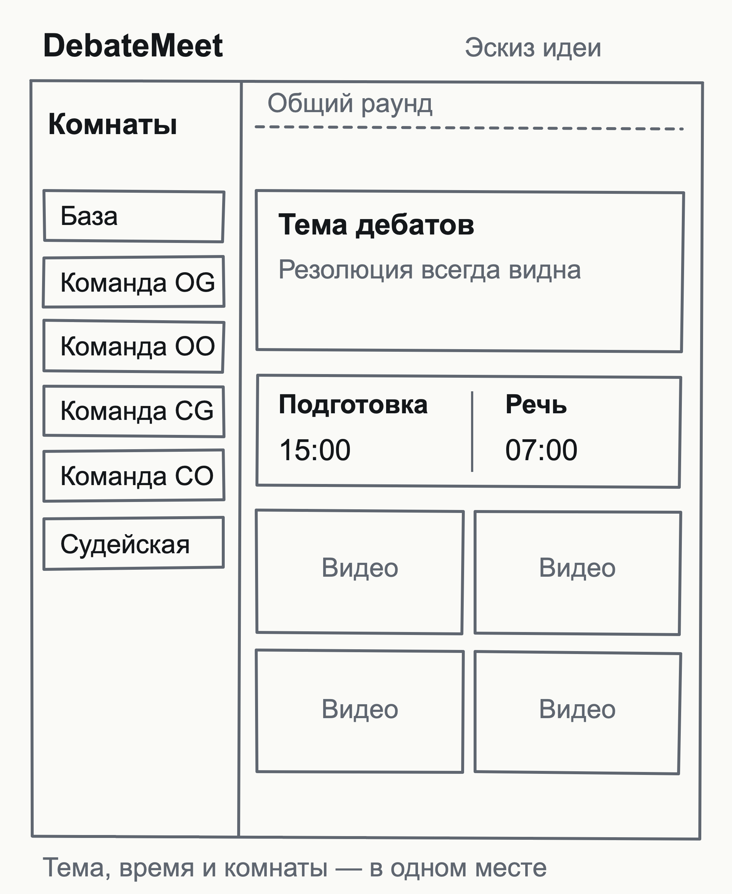

# Интерфейс и медиа клиента

Эта учебная редакция основана на [архитектурном плане от 28 сентября 2026 года](https://github.com/RuslanPogosyants/DebateMeet/blob/229004ced661acd4a724c05530a42337fb2c5824/docs/architecture.md). Номера разделов сохранены, чтобы можно было сопоставить детали с исходным документом. Это план и исходные решения, а не отчет о текущей реализации или пройденных проверках. Актуальное состояние — в [рабочей архитектуре](../../architecture.md) и [README проекта](../../../README.md).

[К общей карте плана](../implementation-plan.md)

## Эскиз интерфейса

На раннем эскизе видны комнаты раунда, участники, тема и таймеры. Он показывает состав экрана, а не окончательный дизайн; поведение переходов и медиа описано ниже.



## 7. Фронтенд

### Гексагон, как на бэкенде

Самый опасный класс багов из спеки — звук подготовки слышен в базе — живёт не в интерфейсе, а в логике подписок. Feature-Sliced Design раскладывает интерфейс по фичам, но не изолирует медиа и состояние от React; гексагон изолирует, и модель на обеих сторонах одна.

```
frontend/src/
  contract/        сгенерировано из OpenAPI: снимок, команды, конверт серверных пакетов
  domain/          чистый TS: правила отображения над снимком
  application/     сценарии клиента, стор, менеджер подписок, порты
  infrastructure/  сессия LiveKit, клиент API, синхронизация часов, телеметрия, localStorage
  ui/              React: страницы, виджеты, селекторы
  main.tsx         корень композиции: собирает адаптеры
```

- **`contract`** — опубликованный язык сервера и клиента; доступен всем слоям. Своих копий типов не заводим.
- **`domain`**: сколько осталось или прошло на таймере с поправкой часов, горит ли защищённое время, когда сигналы, номер руки в очереди, кто в моей комнате, на кого я должен быть подписан. Клиент ничего не решает за сервер — только вычисляет отображение.
- **`application`**: сценарии (войти, перейти в комнату, взять флаг…), стор на Zustand, менеджер подписок. С медиа работает через порт `MediaSession`, не зная LiveKit.
- **`infrastructure`**: адаптер `MediaSession` на `livekit-client` — единственный владелец подписок, прикрепления треков и громкости; `openapi-fetch`; запросы времени; `getStats()`; localStorage с try/catch.
- **`ui`**: читает стор и вызывает сценарии. Треки рисуют тонкие свои компоненты, которые получают трек от `MediaSession` и вызывают `track.attach(el)`. `@livekit/components-react` не используем: его компоненты сами управляют подписками (`VideoTrack` вызывает `setSubscribed`, `RoomAudioRenderer` владеет звуком) и становятся вторым владельцем.

Правила зависимостей те же, что на бэкенде; проверяются `dependency-cruiser` в CI.

### Поток данных — однонаправленный

```
LiveKit: data (снимок, чат,   ┐
         реакции)             │
LiveKit: метаданные (снимок) ─┼─→ стор ─→ ui
LiveKit: треки, кто говорит,  │     │
         качество связи ──────┤     └─→ менеджер подписок ─→ MediaSession
REST: ответы команд, история, ┘
      GET снимка раз в 15 с
ui ─→ сценарий ─→ REST-команда ─→ сервер
```

- Оптимистичных обновлений нет, решает сервер. Инициатор команды сразу применяет снимок из её ответа, остальные получают его пакетом; стор берёт наибольшую пару (epoch, version). Пустые или битые метаданные игнорируются.
- **Кого слушать.** Желаемые подписки = участники, подключённые в LiveKit, ∩ участники снимка, у которых комната — моя. Присутствие в снимке на это не влияет: ложный `disconnected` не должен никого заглушить. Кого нет в снимке, того не слушаем.
- **Порядок при переходе.** Сначала локально заглушить старую комнату → снять подписки на её звук и подписаться на звук новой одной пачкой → для видео сначала отписка, потом подписка (при `subscription_limit_video` лишние подписки ждут свободного слота) → показать новую комнату. Шаги сверяются с последней версией: шаг от устаревшей версии отменяется; ожидание `TrackSubscribed` — не больше 500 мс.
- На звук подписаны все участники моей комнаты, всегда; на видео — только те, чьи плитки нарисованы, остальные — аватары без трафика. Плитка «спикер крупно» выбирается из уже подписанных, с гистерезисом, чтобы подписки не дёргались на каждую смену говорящего; слой меняет adaptiveStream.
- Громкость каждого участника (`setVolume`) заново применяется из localStorage на `TrackSubscribed`: полное переподключение пересоздаёт `RemoteParticipant`.
- Если моя комната сменилась на базу в снимке, который пришёл не ответом на мою команду, — заметный баннер «вас вернули в базу».
- **Таймер.** `requestAnimationFrame` только рисует. Сигналы планируются на часах `AudioContext` и перепланируются при каждом снимке: в фоновой вкладке rAF не вызывается, а сигнал на 7:00 должен прозвучать. Сигналы задним числом не звучат: вошедший посреди речи не слышит уже прошедших.
- **Поправка часов:** несколько запросов времени при входе, медиана, периодическая пересверка.

### Ошибки и крайние случаи

- Браузер заблокировал автовоспроизведение (`AudioPlaybackStatusChanged`) — кнопка «Включить звук» (`startAudio()`).
- Ошибки устройств: `NotAllowedError` — как разрешить доступ; `NotReadableError` — камера или микрофон заняты другим приложением (например, Телемостом); `NotFoundError` — устройства нет. `devicechange` — переподхват устройства, например после смены наушников.
- Команды не проходят (бэкенд недоступен) — баннер «управление недоступно, звонок идёт».
- Плохая связь дольше ~10 с — подсказка «выключите камеру»; держателю флага — уже через 3–5 с.
- Сон дольше 10 минут — повторный вход по id и секрету (раздел 6).
- **Вторая вкладка:** BroadcastChannel и Web Locks. Новая вкладка спрашивает «перенести сюда?»; выбитая показывает «сессия перенесена» и `leave` не шлёт.
- **«Вы ещё здесь?»** Если я единственный подключённый участник раунда дольше 30 минут — вопрос; нет ответа 2 минуты — клиент закрывает свою сессию и показывает «вы вышли» с кнопкой «вернуться». Других людей это не касается.
- Неподдерживаемый браузер — отдельный экран.
- Вышла новая версия — ненавязчивый баннер «обновите страницу между раундами»; `vite:preloadError` — предложение обновить.

### Страницы

Две, без перезагрузок, маршрутизация на React Router:
- `/` — стартовая страница: «Создать раунд» и недавние раунды этого браузера (из localStorage, где уже лежат id и секреты);
- `/r/:roundId` — экран перед входом (проверка устройств и доступности сервера, выбор камеры, имя), затем раунд. Полная проверка медиа — после подключения: для неё нужен токен.

### Отладочная панель

Только для чтения, по сочетанию клавиш, и в проде: состояние соединения, тип ICE-кандидата, подписки, версия снимка, последние ошибки. Проблемы будут на реальных сетях, а не в тестовой сборке.

### Производительность и доступность

- Селекторы Zustand на уровне плитки: снимок и смена говорящего не перерисовывают всё приложение.
- `livekit-client` — ленивым чанком на `/r/:roundId`; бюджет начального JS проверяется в CI.
- Доступность: микрофон с клавиатуры; `aria-live` для «судья просит включить микрофон», «вас вернули в базу», «флаг свободен»; защищённое время и грейс не только цветом; `prefers-reduced-motion` для реакций; `axe` в одном E2E.

### Браузеры

Chrome, Edge и Яндекс Браузер — две последние версии; Safari 17 и новее; Firefox — последний; мобильные — по возможности. `build.target` в Vite — под эту матрицу.

### Прочее

- Стили — Tailwind 4; примитивы (слайдер громкости, меню, диалоги) — Radix через shadcn/ui.
- Интерфейс только на русском; строки в одном модуле, без фреймворка i18n. Коды ошибок домена переводятся в сообщения там же.
- Личные настройки (громкость каждого участника, «скрыть реакции», раскладка) — в localStorage; без хранилища приложение работает.
- TS strict и `noUncheckedIndexedAccess`; oxlint с проверками по типам; Prettier.
