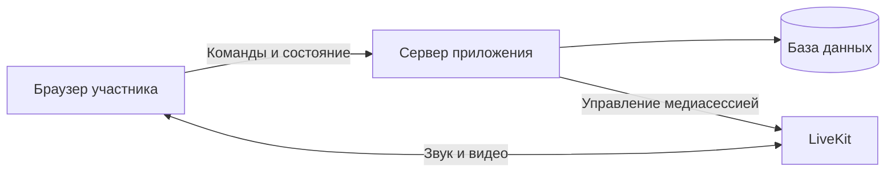

# DebateMeet: план реализации

План переводит [концепцию и требования](concept.md) в архитектурные решения, направления работ и проверяемые этапы. Он подготовлен для курса по материалам начальной спецификации и архитектуры DebateMeet; это учебная редакция исходного плана, а не отчет о текущем состоянии проекта.

Оригинальные документы на начало разработки: [спецификация](https://github.com/RuslanPogosyants/DebateMeet/blob/229004ced661acd4a724c05530a42337fb2c5824/docs/spec.md) и [архитектура с дорожной картой](https://github.com/RuslanPogosyants/DebateMeet/blob/229004ced661acd4a724c05530a42337fb2c5824/docs/architecture.md). Актуальные решения и статус ведутся в [рабочей архитектуре](../architecture.md) и [README](../../README.md).

## 1. Общая структура

Для раунда нужно согласовывать состояние игры и передавать медиа между участниками. В выбранном варианте браузер отвечает за интерфейс и медиа клиента, сервер — за правила и состояние раунда, база — за сохранение данных, LiveKit — за передачу звука и видео.

Для проекта выбраны React и TypeScript на клиенте, FastAPI и Python на сервере, Postgres для хранения состояния и LiveKit для медиасвязи. Это решения под требования DebateMeet, а не обязательный стек для другого проекта.

Логические комнаты раунда не равны отдельным звонкам: клиент получает медиа своей текущей комнаты. Порядок перехода и изоляция звука — ключевые части решения и проверки.

## 2. Серверная часть

### Ответственность

- Создать раунд, принять участника по ссылке, хранить и отдавать согласованное состояние раунда.
- Обрабатывать команды перехода между комнатами, управления судьей, таймерами, резолюцией и жеребьевкой.
- Хранить необходимые данные и передавать изменения клиентам и медиасервису.
- Проверять допустимость команд и сохранять правила раунда независимо от интерфейса.

### Декомпозиция

1. **Модель раунда.** Участники, комнаты, состояние судьи, таймеры и правила переходов. Например, команда возврата группы исполняется вручную судьей.
2. **Прикладные сценарии.** Создание раунда, вход, выход, переход и другие команды. У каждого сценария определены входные данные, результат и ошибки.
3. **Хранение и интеграции.** Сохранение состояния в Postgres и взаимодействие с LiveKit через отдельные адаптеры.
4. **API.** Контракты запросов, ответов и ошибок для интерфейса. Клиент и сервер должны одинаково понимать состояние раунда.

Слои модели, сценариев, интеграций и API позволяют проверять правила отдельно от базы, сети и браузера. Подробное устройство исходного варианта — в [разделе о бэкенде](https://github.com/RuslanPogosyants/DebateMeet/blob/229004ced661acd4a724c05530a42337fb2c5824/docs/architecture.md#4-слои-и-паттерны-бэкенда).

## 3. Интерфейс и медиа клиента

### Ответственность

- Показать раунд, комнаты, участников, тему и время.
- Позволить участнику войти, выбрать устройства и перейти между комнатами.
- Показать действия, доступные судье, и понятные состояния подключения и ошибок.
- Подписывать клиента на медиа нужных участников, не раскрывая звук подготовки другим комнатам.

### Декомпозиция

1. **Экраны и компоненты.** Вход в раунд, карта комнат, область видео и управление игрой.
2. **Клиентские сценарии.** Вход, переход и обработка состояния, полученного от сервера.
3. **Медиаадаптер.** Подключение к LiveKit, подписки на звук и видео и управление устройствами.
4. **Контракты с сервером.** Типы и данные команд и снимка раунда; изменения формата должны учитываться обеими сторонами.

При переходе требуется сначала прекратить получение звука прежней комнаты, затем подключить звук новой. Порядок операций и ситуации с задержанным обновлением состояния нужно проверить отдельно.

## 4. Тестирование и приемка

Проверки планируются вместе с реализацией, а не откладываются на конец проекта.

| Уровень | Что проверяется |
| --- | --- |
| Серверные проверки | Правила раунда, допустимость команд, сохранение состояния и ошибки. |
| Клиентские проверки | Отображение состояния, порядок перехода и выбор медиаподписок. |
| Интеграционные проверки | Взаимодействие сервера с базой, медиасервисом и клиентским контрактом. |
| Сквозной сценарий | Несколько участников входят в раунд, расходятся по комнатам и возвращаются на базу. |
| Проверка на стенде | Реальные устройства и сеть, задержки, восстановление соединения и сценарий пробной игры. |

Для изоляции комнат важно проверить не только доступность звука в своей комнате, но и **отсутствие чужого звука**, в том числе в момент перехода. Подмена устройств в автоматизированном браузере помогает проверять сценарий, но не заменяет физическую проверку микрофона, динамиков и реальной сети.

## 5. Инфраструктура

- Подготовить локальную среду для сервера, базы данных и медиасервиса; описать запуск проекта.
- Настроить проверки кода, типов, контрактов и тестов при изменениях.
- Подготовить сборку и доставку приложения на тестовый стенд; отдельно проверить настройки сети и медиасвязи.
- До использования постоянной среды определить резервное копирование, восстановление, наблюдаемость и порядок обновления.

Локальная среда дает возможность разрабатывать и проверять основные сценарии. Успешный локальный запуск сам по себе не подтверждает работу на стенде или при реальной нагрузке.

## 6. Этапы и зависимости

Этапы объединяют работу разных направлений вокруг проверяемого результата. Номера отражают логику исходной дорожной карты; решения уточняются по мере работы.

| Этап | Результат | Зависимости и проверка |
| --- | --- | --- |
| **0. Среда** | Репозиторий, локальный запуск, базовые проверки и контракты. | Доступны компоненты для совместной разработки и тестов. |
| **1. Вход и общая комната** | Участники входят в раунд и общаются на базе. | Сервер, клиент и медиа соединены; проверены вход и воспроизведение звука. |
| **2. Комнаты** | Участники переходят между комнатами; судья может вручную вернуть группу на базу. | Опирается на вход и медиасвязь; проверяются переход и изоляция комнат. |
| **3. Время** | Судья управляет таймерами, участники видят согласованное время. | Необходимо общее состояние раунда; проверяются запуск, пауза, длительность и отображение. |
| **4. Резолюция, жребий и чат** | Тема доступна участникам, позиции разыгрываются, сообщения передаются в общем чате. | Необходимы состояние и подключение к раунду; проверяются видимость и согласованность данных. |
| **5. Участие** | Руки, ручное управление микрофонами, реакции и личная громкость. | Опирается на работу комнат и медиа; проверяются права действий и состояние участников. |
| **6. Устойчивость** | Подсказки при проблемах связи, повторный вход и диагностика. | Нужны основные пользовательские сценарии для проверки восстановления. |
| **Стенд и пробная игра** | Проверка собранного приложения на устройствах и в реальной сети. | Проверяются доступность сервисов, задержки, изоляция и полный сценарий раунда. |

Первоначально стенд предполагался до пользовательских срезов; позже порядок изменили и перенесли стенд после локальной работы над ними. Причина и последствия зафиксированы в [ADR 0001](../adr/0001-stand-after-slice-6.md). Это пример того, как план может меняться при появлении новых ограничений.

## 7. Основные риски и проверки

| Риск | Что проверить |
| --- | --- |
| Звук подготовки слышен за пределами комнаты. | Разные источники звука, несколько комнат и все моменты перехода; убедиться, что чужой звук не воспроизводится. |
| Участники видят разные состояния таймера или раунда. | Запуск и пауза, задержанные сообщения, повторный вход и восстановление соединения. |
| Устройства, браузеры или сеть ведут себя иначе, чем в локальном тесте. | Отдельные проверки на реальных устройствах и сетях, а также сценарии отказа и потери связи. |
| Изменение одной части нарушает договоренность между клиентом и сервером. | Проверка контракта, совместная интеграция и сквозной сценарий на каждом затронутом этапе. |

## 8. Использование плана

Перед началом этапа уточните его границы и состав работ. Проверьте, какие требования он закрывает, какие решения еще не приняты, от чего зависит выполнение и чем будет подтвержден результат. После проверки скорректируйте план и сохраните принятые решения и открытые вопросы в документации.
